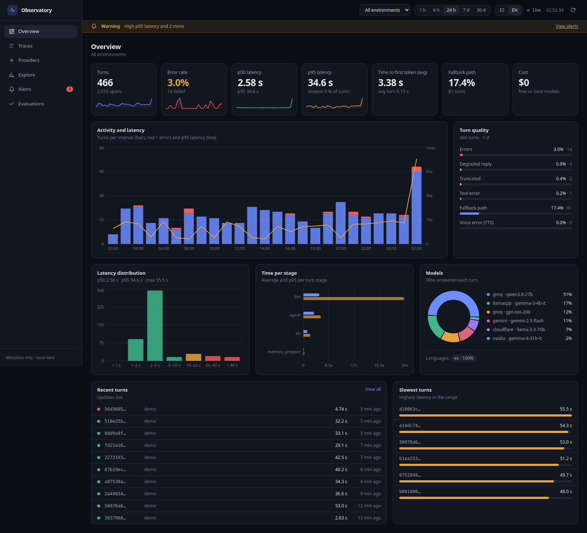
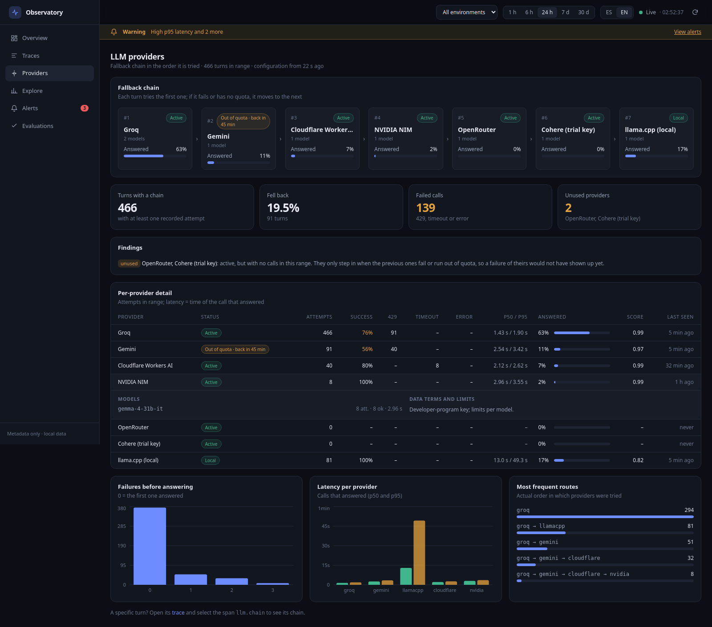
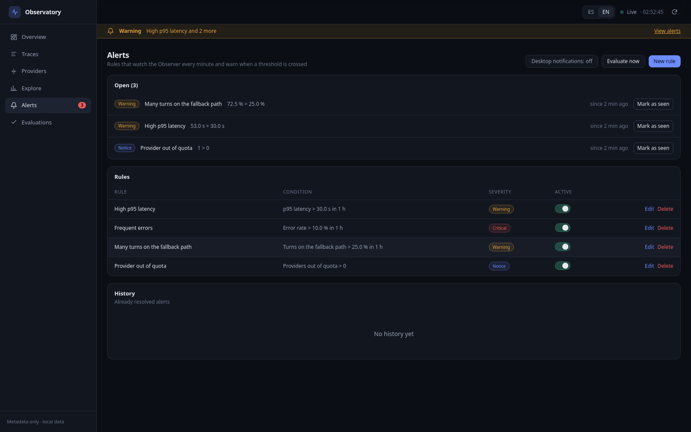
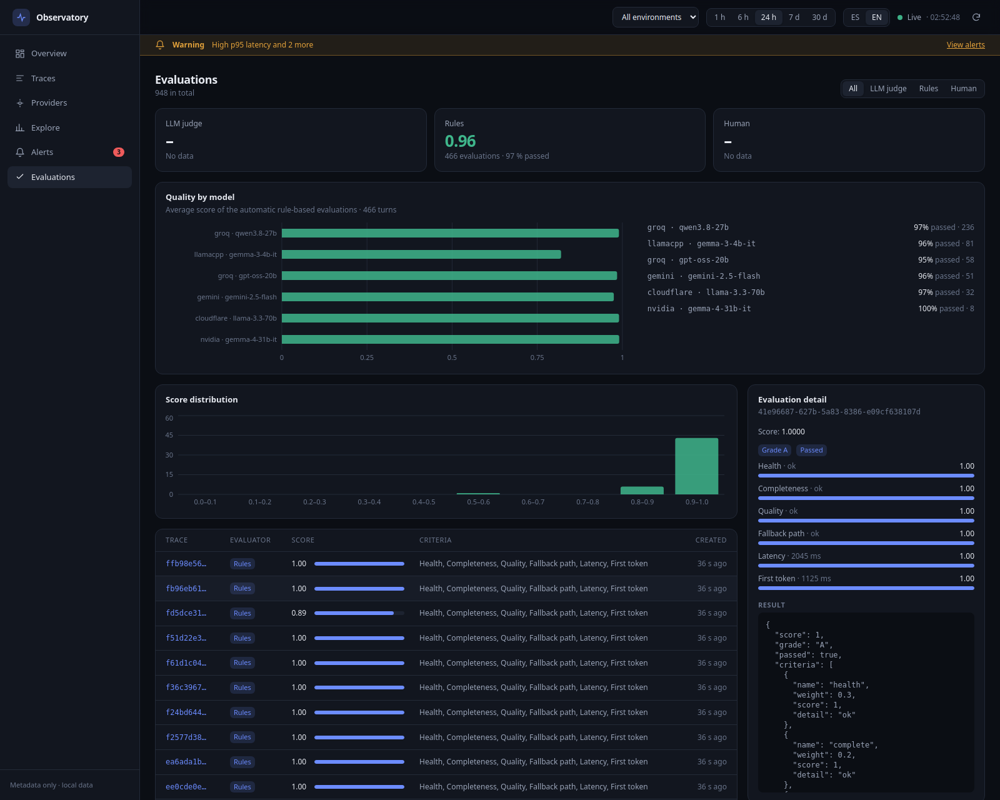
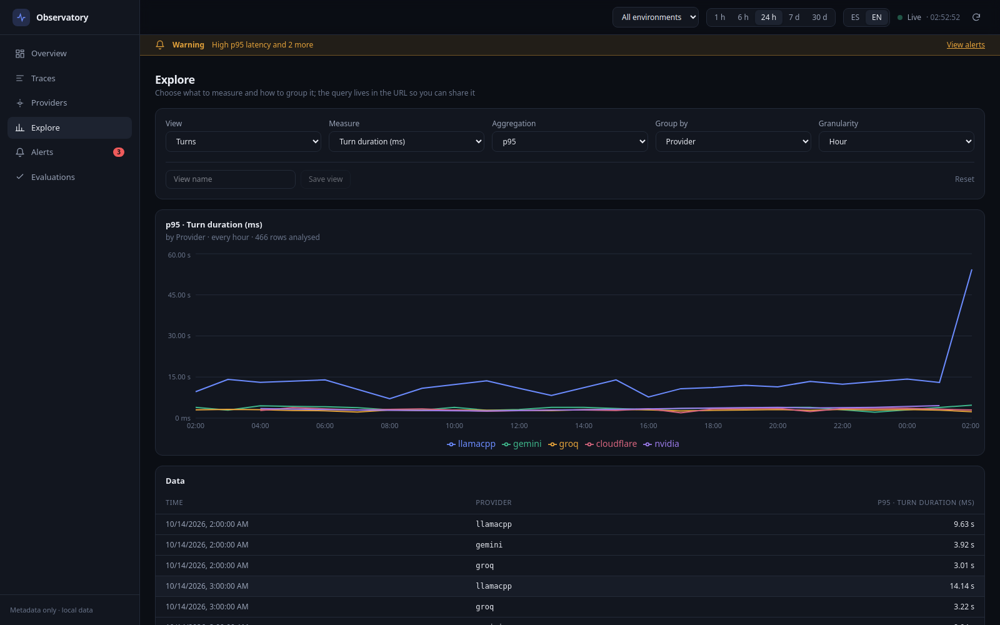
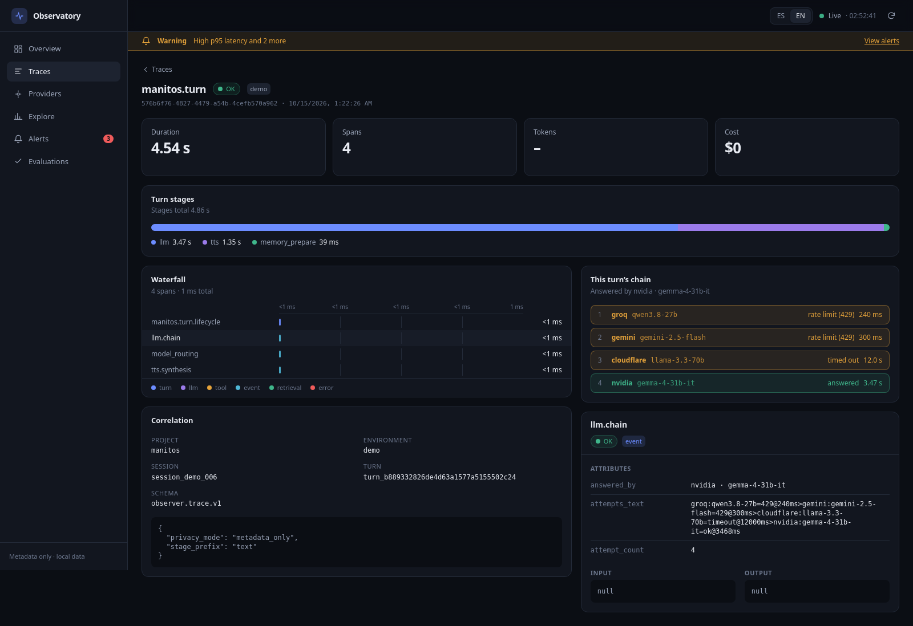

# LLM Observatory

[](LICENSE)
[](https://github.com/Magic-Lab-Studio/observer/actions/workflows/ci.yml)
[](https://pypi.org/project/magic-lab-observer/)
[](https://www.npmjs.com/package/@magic-lab-studio/observer)

Observer is a local-first, self-hosted observability and evaluation platform for
LLM and agentic systems. It stores traces in SQLite or PostgreSQL that you
control, works with local or hosted models, and requires no Observer cloud
account.



_The dashboard above was rendered from synthetic telemetry. The clean-runner
[quickstart smoke test](.github/workflows/quickstart-smoke.yml) still captures its own screenshot
as a CI artifact._

## What's new: a redesigned dashboard

The dashboard was rebuilt as a dense, dark console: sidebar navigation, a global time range and
environment filter, live updates, and charts that use the whole screen. The interface is available in
English and Spanish: pick the language with the ES/EN switch in the header (the choice is remembered;
the default follows the browser language).

- **Overview** — turns, error rate, p50/p95 latency, time to first token, fallback rate and cost
  (always shown, even at $0), an activity/latency chart, latency histogram, per-stage time and model
  share. The series and latency KPIs come from the metrics query, so 7 d and 30 d ranges use every turn.
- **Providers** — your LLM fallback chain in the order it is tried, with per-provider success rate,
  429/timeout/error counts, p50/p95 latency, how often each one answered, fallback depth, common routes
  and the average turn score. It flags providers that are configured but never reached.



- **Alerts** — threshold rules over a sliding window (error rate, p95 latency, fallback rate, provider
  failures, providers out of quota, ...), a global banner and optional desktop notifications.



- **Evaluations** — every turn is scored without a model (health, completeness, quality, fallback,
  latency, time to first token), with quality by model and the per-criterion breakdown of each turn.



- **Explore** — a query builder over turns, provider attempts and evaluations (measure, aggregation,
  group by, granularity). The query lives in the URL so it can be shared, and views can be saved.



- **Trace detail** — a hierarchical waterfall, a per-stage time bar and, for `llm.chain` spans, the
  provider-by-provider attempts of that turn.



The Providers page reads `llm.chain` spans and an optional metadata-only provider snapshot
(`POST /v1/providers/snapshot`, never keys); see
[docs/manitos-integration.md](docs/manitos-integration.md#llm-provider-chain-proveedores-page).
_These screenshots were rendered from synthetic telemetry._

## Features

- **Multi-framework tracing** — Auto-instrument OpenAI, Anthropic, LangChain
- **Agent runtime integration** — Versioned adapters for metadata-only telemetry
- **Cost tracking** — Per-model pricing for 20+ models (GPT-4o, Claude 4, Gemini 2.0, etc.)
- **Evaluation engine** — LLM-as-Judge with YAML rubric, rule-based metrics, human feedback
- **Real-time dashboard** — Live trace streaming via WebSocket, time-range filtering
- **CLI tools** — Query, export, import, and evaluate traces from the terminal
- **SQLite & PostgreSQL** — Local dev with SQLite, production with PostgreSQL

## Privacy and data collection

Observer has no built-in product analytics or managed telemetry service. Your
Observer data plane runs on infrastructure you control. What enters that data
plane depends on how you instrument the application:

- Generic Python and TypeScript auto-instrumentation captures model inputs and
  outputs, token usage, timing, cost, status, model/provider identifiers, and
  user-supplied span attributes by default. Inputs and outputs can contain raw
  prompts or model responses.
- Direct HTTP instrumentation can be metadata-only: omit `input` and `output`
  and send only the operational fields your retention policy permits.
- The reference runtime integration is documented for metadata-only telemetry.
  Its compatibility schema still accepts generic `input` and `output` fields,
  so exporters must omit content and deployments should verify stored data.
- Observer does not require actor identity, provider credentials, or secrets in
  trace payloads. Do not place API keys, personal data, or secret-bearing URLs
  in spans or attributes.
- Rule-based evaluation stays local. Enabling LLM-as-Judge with
  `OPENAI_API_KEY` sends the selected evaluation context to the configured model
  provider under that provider's data policy.

Treat the database as sensitive whenever content capture is enabled. Configure
authentication, TLS, access control, backups, retention, and deletion before a
shared deployment. See [First-time setup](docs/first-time-setup.md#4-choose-a-privacy-mode).

## How Observer compares

Observer deliberately favors a small, inspectable self-hosted deployment over
the broadest integration catalog. This table is a starting point, not a claim
that one tool fits every team.

| Project | Strongest fit | Where it is stronger than Observer | Where Observer is simpler |
| --- | --- | --- | --- |
| **Observer** | A compact local data plane with traces, evaluations, cost/latency analytics, CLI, and dashboard | — | SQLite for a single-node start; API, dashboard, and database are the complete core stack |
| [Langfuse](https://langfuse.com/docs/observability/overview) | Mature end-to-end LLM engineering workflows | Prompt management, datasets, experiments, custom dashboards, and production-scale ingestion | Observer avoids the ClickHouse, Redis/Valkey, and object-storage services used by production Langfuse self-hosting |
| [Arize Phoenix](https://arize.com/docs/phoenix/) | OpenTelemetry/OpenInference tracing and systematic experimentation | Broader instrumentation, datasets, experiments, prompt playground, and a larger ecosystem | Observer offers a narrower API and SQLite path when those workflows are unnecessary |
| [Helicone](https://docs.helicone.ai/getting-started/platform-overview) | Gateway-first routing and observability | Provider gateway, routing, and proxy-based onboarding | Observer is not in the model request path and can ingest traces directly |
| [OpenLLMetry](https://github.com/traceloop/openllmetry) | OpenTelemetry instrumentation for an existing observability stack | Much broader provider, framework, vector database, and OTLP backend coverage | Observer includes its own storage, analytics API, evaluation engine, CLI, and dashboard |

Comparison checked against the linked project documentation on 2026-08-07.

## Quick Start

For a guided installation, first trace, application integration, privacy choices,
and production checklist, see [First-time setup](docs/first-time-setup.md).

Copy [`.env.example`](.env.example) when you need to customize the backend. The
checked-in values are development examples, not production credentials.

### Docker Compose (recommended)

```bash
git clone https://github.com/Magic-Lab-Studio/observer.git
cd observer
docker compose up -d
```

| Service    | URL                      |
|------------|--------------------------|
| Backend    | http://localhost:8000     |
| Dashboard  | http://localhost:5173     |
| PostgreSQL | localhost:5432           |

### Podman Compose

```bash
podman-compose up -d
```

### Manual Setup

**1. Start PostgreSQL:**

```bash
podman run -d --name postgres -p 5432:5432 \
  -e POSTGRES_PASSWORD=postgres -e POSTGRES_DB=observatory \
  postgres:16-alpine
```

**2. Backend:**

```bash
cd backend
pip install -e ".[dev,sqlite]"
alembic upgrade head
uvicorn app.main:app --reload
```

**3. Dashboard:**

```bash
cd dashboard
npm install
npm run dev
```

## Project Structure

```
observer/
├── backend/                  # FastAPI backend + evaluation engine
│   ├── app/
│   │   ├── api/              # Route handlers (traces, evaluations, analytics)
│   │   ├── evaluators/       # LLM-as-Judge, rubric engine (YAML/JSON)
│   │   ├── models/           # SQLAlchemy models
│   │   └── main.py           # App entrypoint, health check
│   └── alembic/              # Database migrations
├── dashboard/                # React + Vite + Tailwind
│   └── src/
│       ├── pages/            # Overview, Traces, TraceDetail, Evaluations
│       ├── components/       # TraceWaterfall, ErrorBoundary, shared
│       ├── api.ts            # Centralized API client
│       └── types.ts          # Shared TypeScript interfaces
├── sdk/
│   ├── python/               # magic-lab-observer PyPI package
│   └── typescript/           # @magic-lab-studio/observer npm package
├── cli/                      # llm-observatory CLI
├── docker-compose.yml
├── podman-compose.yml
└── .github/workflows/ci.yml
```

## Backend API

Base URL: `http://localhost:8000`

| Method   | Endpoint                          | Description                      |
|----------|-----------------------------------|----------------------------------|
| `GET`    | `/health`                         | Health check (db status, version)|
| `POST`   | `/v1/traces/batch`                | Ingest traces                    |
| `POST`   | `/v1/ingest/manitos/traces`       | Versioned integration ingestion   |
| `GET`    | `/v1/traces`                      | List traces (paginated)          |
| `GET`    | `/v1/traces/{id}`                 | Get trace detail                 |
| `DELETE` | `/v1/traces/{id}`                 | Delete trace                     |
| `POST`   | `/v1/traces/batch-delete`         | Bulk delete traces               |
| `GET`    | `/v1/traces/{id}/evaluations`     | Evaluations for a trace          |
| `GET`    | `/v1/traces/export`               | Export traces as JSON            |
| `POST`   | `/v1/evaluations`                 | Create evaluation                |
| `POST`   | `/v1/evaluations/run`             | Run evaluator on a trace         |
| `GET`    | `/v1/evaluations/summary`         | Aggregated eval stats            |
| `GET`    | `/v1/analytics/summary`           | Trace analytics                  |
| `GET`    | `/v1/analytics/timeline`          | Trace counts over time           |
| `GET`    | `/v1/analytics/cost-by-model`     | Cost breakdown by model          |
| `GET`    | `/v1/analytics/sessions`          | Unique sessions with stats       |
| `GET`    | `/v1/analytics/manitos-quality`   | Integration quality and latency   |
| `GET`    | `/v1/providers/`                  | LLM provider chain statistics     |
| `POST`   | `/v1/providers/snapshot`          | Provider configuration snapshot   |
| `GET`    | `/v1/alerts/metrics`              | Metrics an alert rule can watch   |
| `GET`    | `/v1/alerts/rules`                | List alert rules                  |
| `POST`   | `/v1/alerts/rules`                | Create an alert rule              |
| `PATCH`  | `/v1/alerts/rules/{id}`           | Edit or enable/disable a rule     |
| `DELETE` | `/v1/alerts/rules/{id}`           | Delete a rule and its events      |
| `GET`    | `/v1/alerts/events`               | Alert events (`?state=open`)      |
| `POST`   | `/v1/alerts/events/{id}/ack`      | Mark an alert as seen             |
| `POST`   | `/v1/alerts/evaluate`             | Evaluate all rules now            |
| `GET`    | `/v1/evaluations/by-model`        | Turn quality by model and provider|
| `POST`   | `/v1/analytics/query`             | Flexible metrics query            |
| `GET`    | `/v1/analytics/query/schema`      | Views, measures and dimensions    |

The integration endpoint uses the versioned `manitos.telemetry.v1` envelope, accepts
opaque session identifiers, and safely deduplicates exporter retries. See
[docs/manitos-integration.md](docs/manitos-integration.md) for the published contract.

### Metrics explorer

`POST /v1/analytics/query` aggregates stored telemetry by dimension and time, in the spirit of
Langfuse's metrics API. A request names a **view** (`turns`, `provider_attempts` or `evaluations`),
**metrics** (a measure plus `count`, `sum`, `avg`, `min`, `max`, `p50`, `p95` or `p99`; `avg` of a
0/1 field is a rate), up to two **dimensions** to group by (environment, model, provider, language,
intent, status, ...), **filters** (`=`, `!=`, `in`), a range (`hours` or `from_time`/`to_time`), an
optional **granularity** (`minute`, `hour`, `day` or `auto`) and a `row_limit` (at most 1000).
Every field is checked against a fixed list per view (`GET /v1/analytics/query/schema`), so nothing
in the request becomes a column or an expression; session and turn ids can filter but never group.

```json
{"view": "turns", "hours": 168, "granularity": "day",
 "metrics": [{"measure": "duration_ms", "aggregation": "p95"}],
 "dimensions": ["provider"],
 "filters": [{"field": "environment", "op": "=", "value": "prod"}]}
```

The dashboard's **Explore** page builds these queries from selectors, keeps the query in the URL so
it can be shared, and saves named views in the browser. The Overview reads its series and latency
KPIs from the same endpoint, so 7 d and 30 d ranges use every turn.

### Automatic turn evaluations

Every Manitos turn is scored without a model by a deterministic rubric (`manitos_turn@1`): health
(error / tool error), completeness (truncated), quality (degraded), fallback, latency and time to
first token, with fixed weights; a turn passes at 0.6 unless it failed outright. A background sweep
(`OBSERVATORY_AUTO_EVAL_INTERVAL_SEC`, default 60; `OBSERVATORY_AUTO_EVAL=0` turns it off;
`OBSERVATORY_AUTO_EVAL_DAYS`, default 7) scores recent turns that have no evaluation yet and also
backfills history. Evaluations are idempotent (the id derives from the trace and the rubric). The
Evaluations page shows the score by model, the grade and the per-criterion breakdown of each turn.

### Alerts

Rules watch a metric over a sliding window (error rate, p50/p95 latency, share of turns on the
fallback path, degraded/truncated replies, provider failures, providers out of quota) and fire
when it crosses a threshold with enough samples. A rule resolves once the value is back inside the
threshold by a 10 % margin, then waits for its cooldown before it can fire again. Open alerts show
as a banner in the dashboard and, optionally, as browser desktop notifications. Four default rules
are created on first start (`OBSERVATORY_ALERTS_DEFAULTS=0` skips them); `OBSERVATORY_ALERTS=0`
turns the evaluator off and `OBSERVATORY_ALERT_INTERVAL_SEC` (default 60) sets its period.

### Example: Ingest a trace

```bash
curl -X POST http://localhost:8000/v1/traces/batch \
  -H "Content-Type: application/json" \
  -d '{
    "spans": [{
      "trace_id": "demo-001",
      "name": "gpt-4o-call",
      "span_type": "llm",
      "start_time": "2025-01-01T00:00:00Z",
      "end_time": "2025-01-01T00:00:01Z",
      "status": "ok",
      "tokens_input": 150,
      "tokens_output": 50,
      "cost_usd": 0.000875
    }]
  }'
```

## Python SDK

```bash
pip install magic-lab-observer==0.1.1
```

For editable SDK development from a checkout:

```bash
python -m pip install "./sdk/python[openai,anthropic,langchain]"
```

See [First-time setup](docs/first-time-setup.md#3-instrument-an-application)
for package identities and integration examples.

```python
from llm_observatory import instrument, trace
from llm_observatory.tracer import Tracer

# Auto-instrument LLM libraries
instrument(openai=True, anthropic=True, langchain=True)

# Or trace functions manually
@trace(name="summarize")
def summarize(text: str) -> str:
    return openai.chat.completions.create(
        model="gpt-4o",
        messages=[{"role": "user", "content": text}]
    )

# Custom tracer with OTLP exporter
tracer = Tracer(service_name="my-app")
from llm_observatory.exporters.otlp import OTLPExporter
tracer.add_exporter(OTLPExporter(endpoint="http://localhost:8000"))
```

### Supported providers

| Provider   | Auto-instrument | Manual trace |
|------------|-----------------|--------------|
| OpenAI     | Yes             | Yes          |
| Anthropic  | Yes             | Yes          |
| LangChain  | Yes             | Yes          |
| Gemini     | Manual only     | Yes          |

## TypeScript SDK

```bash
npm install @magic-lab-studio/observer
```

```typescript
import { instrument, trace, asyncTrace, Tracer } from "@magic-lab-studio/observer";

// Auto-instrument
instrument({ openai: true, anthropic: true });

// Trace async functions
const result = await asyncTrace("summarize", async (span) => {
  const response = await openai.chat.completions.create({
    model: "gpt-4o",
    messages: [{ role: "user", content: text }],
  });
  span.attributes["model"] = "gpt-4o";
  return response;
});

// Custom tracer with OTLP exporter
const tracer = new Tracer({ serviceName: "my-app" });
import { OTLPExporter } from "@magic-lab-studio/observer";
tracer.addExporter(new OTLPExporter({ endpoint: "http://localhost:8000" }));
```

## CLI

```bash
pip install magic-lab-observer-cli==0.1.1
```

For editable CLI development from a checkout:

```bash
python -m pip install ./cli
```

```bash
# List traces from local SQLite
llm-observatory traces --db observatory.db

# Inspect a specific trace and its spans
llm-observatory inspect <trace-id>

# Show summary statistics
llm-observatory stats

# Export traces to JSON
llm-observatory export -o traces.json

# Import traces from JSON
llm-observatory import traces.json

# Dry-run import (preview only)
llm-observatory import traces.json --dry-run

# Run an evaluation
llm-observatory evaluate --trace-id abc123 --evaluator llm_judge

# Check server status
llm-observatory status
```

## Evaluation System

The LLM-as-Judge evaluator uses a YAML rubric with 7 criteria:

| Criterion        | Weight | Scale |
|------------------|--------|-------|
| Relevance        | 1.5    | 0-5   |
| Accuracy         | 1.5    | 0-5   |
| Completeness     | 1.0    | 0-5   |
| Coherence        | 1.0    | 0-5   |
| Conciseness      | 0.8    | 0-5   |
| Safety           | 1.2    | 0-5   |
| Hallucination    | 1.5    | 0-5 (inverted) |

Configure the judge model:

```bash
export OPENAI_API_KEY=sk-...
export OBSERVATORY_JUDGE_MODEL=gpt-4o  # default
```

## Development

### Run tests

```bash
# Backend (170 tests)
cd backend && pytest

# Python SDK (37 tests)
cd sdk/python && pytest

# TypeScript SDK (30 tests)
cd sdk/typescript && npx vitest run

# CLI (63 tests)
cd cli && pytest
```

### Lint & typecheck

```bash
ruff check backend/ sdk/python/ cli/
cd sdk/typescript && npx tsc --noEmit
cd dashboard && npx tsc --noEmit
```

## Architecture

```
┌─────────────────────────────────────────────────────────────────────┐
│                          LLM Observatory                            │
├──────────────┬──────────────┬───────────────┬───────────────────────┤
│  Python SDK  │ TypeScript   │    Backend    │     Dashboard         │
│  (pip)       │ SDK (npm)    │   (FastAPI)   │   (React + Vite)      │
│              │              │               │                       │
│  OpenAI      │  OpenAI      │  /v1/traces   │   Overview            │
│  Anthropic   │  Anthropic   │  /v1/evals    │   Traces              │
│  LangChain   │              │  /v1/analytics│   Trace Detail        │
│  OTLP export │  OTLP export │  WebSocket    │   Evaluations         │
└──────┬───────┴──────┬───────┴───────┬───────┴───────────┬───────────┘
       │              │               │                   │
       └──────────────┴───────────────┴───────────────────┘
                                     │
                          ┌──────────┴──────────┐
                          │     PostgreSQL      │
                          │   (or SQLite)       │
                          └─────────────────────┘
```

## License

Apache License 2.0 — see [LICENSE](LICENSE) for details.

Contributions are welcome. See [CONTRIBUTING.md](CONTRIBUTING.md) for setup,
verification, compatibility, and privacy requirements.
